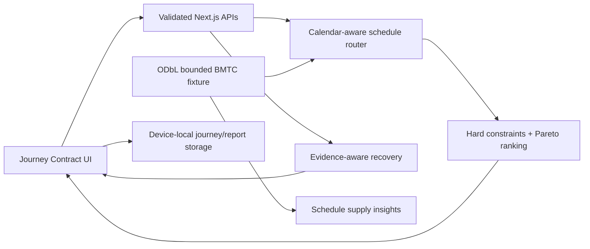

<div align="center">

# NammaLink

### Reach on Time. Wait Less.

**A constraint-aware scheduled public-transport planner and journey-recovery prototype for Bengaluru**

[](#verification)
[](#verification)
[](#native-android-app)
[](#data-and-honesty)
[](#hackathon)

</div>

> [!IMPORTANT]
> NammaLink is a runnable engineering prototype using an unofficial static community GTFS fixture. Results are **scheduled**, not live. The recovery incident is explicitly simulated. No deployment URL, authorized realtime feed, or trained delay model is claimed.

## What works

- Arrive-by journey planning for the Jain University–Alliance University demonstration.
- Maximum walking and transfer limits enforced before ranking.
- Fastest, least-waiting, least-walking, direct-preferred, and direct-only choices.
- Dataset-supported Jain Gate → Banashankari → Chikka Hagade Gate itinerary.
- Source-labelled stop timeline, wait, walking, transfer, and deadline evidence.
- Evidence states preventing unverified reports from becoming closures.
- Simulated missed-connection recovery that preserves the completed first leg.
- Connection status, saved last journey, local report queue, manifest, and service-worker shell cache.
- Bounded schedule-supply insights for operators.
- Responsive browser-verified interface.
- Native Kotlin/Jetpack Compose Android app built, installed, and flow-tested on a physical Android 16 phone.
- Reproducible 9,960-stop BMTC index and provenance-labelled `/api/stops` search for arbitrary feed-supported stop selection.
- Full-feed Connection Scan endpoint covering 57,836 trips and 1,477,697 plausibility-filtered scheduled connections.

## Native Android app

The `android/` project is a real Compose application—not a WebView. Its first verified milestone includes constraint controls, a GTFS-derived demonstration journey, a native route schematic, persisted offline save state, a clearly simulated recovery flow, and honest operator insights.

Requirements: Android SDK 36, JDK 17+ (Android Studio's bundled JDK is recommended), and an authorized USB device or emulator.

```powershell
Set-Location android
$env:ANDROID_HOME = "$env:LOCALAPPDATA\Android\Sdk"
.\gradlew.bat :app:assembleDebug
.\gradlew.bat :app:installDebug
```

The generated development APK is under `android/app/build/outputs/apk/debug/`. Build artifacts and signing material are intentionally excluded from Git. See [ML training report](docs/ML_TRAINING_REPORT.md) for the evidence gate and [work checkpoint](docs/WORK_CHECKPOINT.md) for verified device details.

## Central demonstration

With a 10:05 arrival deadline, 800 m walking maximum, and one transfer maximum, the bounded schedule returns:

| Metric | Result |
| --- | --- |
| Door departure | 06:39 |
| First leg | `O EXP V-213VJ`, Jain University Gate 06:45 → Banashankari 08:00 |
| Second leg | `600-CA`, Banashankari Platform 7 08:05 → Chikka Hagade Gate 09:54 |
| Door arrival | approximately 09:58 |
| Scheduled wait | 5 minutes |
| Estimated walking | 757 m |
| Transfers | 1 |

Direct-only mode returns no result in the bounded fixture. A simulated incident removes the 08:05 second trip; the engine preserves the completed first leg and recommends boarding the next `600-CA` at 08:45, while clearly warning that the original deadline is no longer feasible.

## Architecture



See [Architecture](docs/ARCHITECTURE.md) and [Algorithms](docs/ALGORITHMS.md).

## Stack

- Next.js 16 App Router, React 19, strict TypeScript.
- Kotlin, Jetpack Compose, Android Gradle Plugin 9.2.1, and Gradle 9.4.1.
- Zod request validation.
- Vitest unit and integration tests.
- Pure TypeScript schedule routing and recovery.
- Browser local storage plus a small service worker.
- No database or paid service required for the core demo.

## Local setup

Requirements: Node.js 20+ and npm (the verified development machine used Node 25.9.0).

```powershell
git clone https://github.com/DSGAMING98/NammaLink.git
Set-Location NammaLink
npm install
npm run dev
```

Open `http://localhost:3000`.

Useful commands:

```powershell
npm run test:run
npm run typecheck
npm run build
npm run start
```

To rebuild the committed fixture from a local BMTC feed:

```powershell
$env:BMTC_GTFS_DIR = '..\bmtc'
npm run data:build
```

## Environment variables

Copy `.env.example` to `.env.local` and fill only services you intend to enable. Every slot is blank in Git.

| Variable | Scope | Current prototype use |
| --- | --- | --- |
| `NEXT_PUBLIC_GOOGLE_MAPS_API_KEY` | Browser | Planned map; not required for core |
| `NEXT_PUBLIC_GOOGLE_MAPS_MAP_ID` | Browser | Planned map style |
| `GOOGLE_ROUTES_API_KEY` | Server | Planned supplemental routes |
| `GOOGLE_PLACES_API_KEY` | Server | Blocked by HTTP 403 in minimal probes |
| `GOOGLE_GEOCODING_API_KEY` | Server | Not enabled in core |
| `OVERPASS_API_URL` | Server/tooling | Optional future pedestrian context |
| `NEXT_PUBLIC_SUPABASE_URL` | Browser | Authentication not enabled |
| `NEXT_PUBLIC_SUPABASE_ANON_KEY` | Browser | Authentication not enabled |
| `SUPABASE_SERVICE_ROLE_KEY` | Server only | Never expose to browser; backend unverified |

Never commit `.env.local` or credentials.

## Data and honesty

The committed `data/demo-network.json` is a reproducible 241 KB derivative of [Vonter's community BMTC GTFS](https://github.com/Vonter/bmtc-gtfs), feed version `20260907`, under ODbL 1.0. It contains 3 routes, 216 referenced stops, 53 trips, and 1,343 stop times. Attribution and checksum are documented in [Dataset Inventory](docs/DATASET_INVENTORY.md).

Locally audited but not committed: full BMTC and BMRCL GTFS, historical BMRCL ridership workbooks, and supporting KML/CSV data. No KSRTC feed, authorized realtime transit feed, or labelled arrival-delay dataset was found.

Consequences:

- Scheduled times are not guaranteed arrivals.
- Walking uses straight-line distance at 1.25 m/s, not a pedestrian graph.
- No supervised ML accuracy is reported; see [ML Experiments](docs/ML_EXPERIMENTS.md).
- Operator metrics describe schedule supply, not occupancy or real fleet utilization.
- Google map/place integration is not part of the working core.

## Verification

At the latest documented checkpoint:

- 22 tests across 9 files pass.
- Strict TypeScript checking passes.
- Production build passes.
- Journey and recovery APIs are integration-tested.
- Desktop and 390×844 mobile journey flows were browser-verified.
- Saved-journey restore, local queue, connectivity indicator, recovery, and operator insights were browser-verified.

Detailed methodology and limitations: [Evaluation Results](docs/EVALUATION_RESULTS.md).

## Security, privacy, and offline behavior

- Server-only secrets remain outside client code and Git.
- Public API inputs are bounded and validated.
- Security headers block framing and MIME sniffing.
- The service worker never caches `/api/` responses.
- Saved journeys and queued reports stay on the current device.
- No continuous GPS or account is required.
- Live alerts, fresh routing, and online map tiles do not work without connectivity.
- Authentication, moderator RBAC, RLS, retention, and upload controls remain planned until a backend is verified.

## Competitive position

Google Maps, Moovit, Chennai One, and official BMTC systems already provide important combinations of routing, realtime information, alerts, tracking, or ticketing. NammaLink's narrow focus is an explicit Journey Contract, minimum-waiting/direct preferences, evidence-aware reports, and recovery of the unfinished journey. See [Competitor Analysis](docs/COMPETITOR_ANALYSIS.md).

## Hackathon

| Field | Detail |
| --- | --- |
| Team | MONOLIMO |
| Team ID | Shastra26/CS-019 |
| Event | Alliance University Alliance ONE 2026, CodeSangram 3.0 |
| Problem | CS/26-002 — Smart Public Transport Optimization |
| Theme | Solving for Bengaluru |
| Alignment | SDG 11 — Sustainable Cities and Communities |

Demo instructions and judge Q&A: [Hackathon Demo](docs/HACKATHON_DEMO.md).

## Documentation

- [Project Audit](docs/PROJECT_AUDIT.md)
- [Dataset Inventory](docs/DATASET_INVENTORY.md)
- [Architecture](docs/ARCHITECTURE.md)
- [Algorithms](docs/ALGORITHMS.md)
- [ML Experiments](docs/ML_EXPERIMENTS.md)
- [Evaluation Results](docs/EVALUATION_RESULTS.md)
- [Competitor Analysis](docs/COMPETITOR_ANALYSIS.md)
- [Implementation Status](docs/IMPLEMENTATION_STATUS.md)
- [Work Checkpoint](docs/WORK_CHECKPOINT.md)
- [Hackathon Demo](docs/HACKATHON_DEMO.md)

## Roadmap

1. Replace request-time bounded enumeration with preprocessed CSA/RAPTOR and a spatial index.
2. Integrate full BMTC/BMRCL service calendars and pedestrian-network walking.
3. Add arbitrary place selection and a map after Google API access is repaired.
4. Secure a legitimate realtime feed and preserve source semantics.
5. Add Supabase authentication, passenger/moderator roles, RLS, and retention only after backend verification.
6. Add in-app alert deduplication, then optional push/email/SMS providers when configured.
7. Train delay models only after labelled observed arrivals exist.
8. Run device-level offline, accessibility, and field-journey validation.
9. Deploy only after secrets, licences, monitoring, and full regression checks pass.

## Licence

No licence has been selected for NammaLink source code. Do not assume permission to redistribute it. Dataset licences are separate; the committed demonstration database remains subject to ODbL 1.0 and upstream/operator rights.
