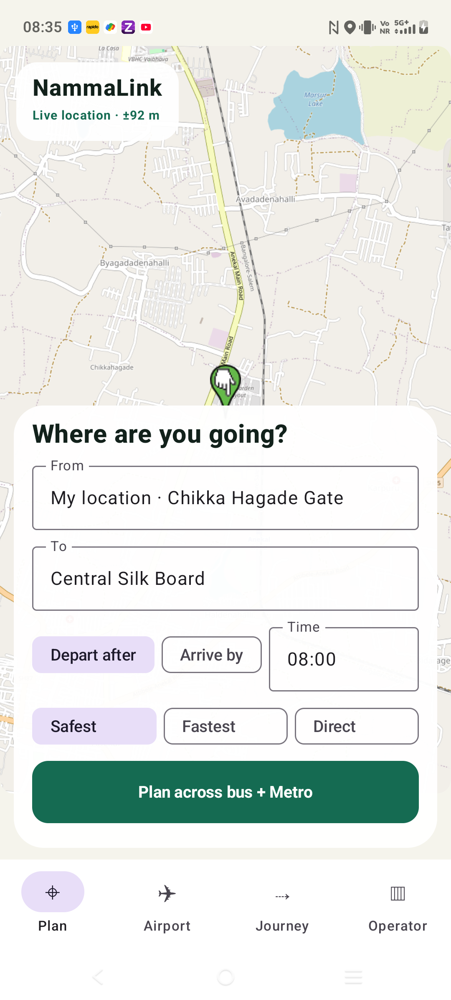
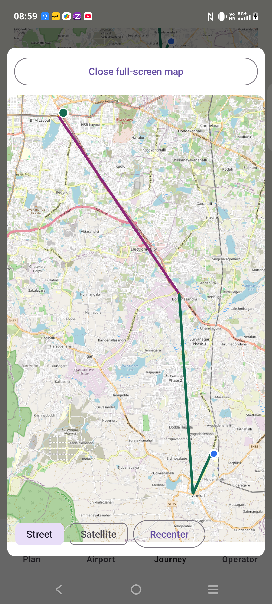
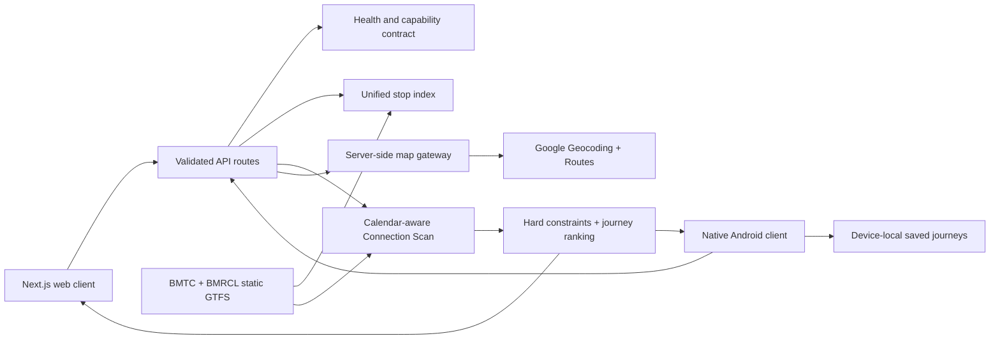

<div align="center">


# NammaLink

### Reach on time. Wait less.

**Constraint-aware public transport planning for Bengaluru**

[](https://nammalink.vercel.app)
[](https://github.com/DSGAMING98/NammaLink/actions/workflows/ci.yml)
[](#verification)
[](#android-application)
[](#data-sources-and-limitations)

[Open NammaLink](https://nammalink.vercel.app) · [Download Android APK](https://nammalink.vercel.app/downloads/NammaLink-0.1.0.apk) · [API health](https://nammalink.vercel.app/api/health)

</div>

## Overview

NammaLink is a web and native Android journey planner for Bengaluru's bus and Metro networks. It searches calendar-aware static schedules, applies passenger constraints before ranking results, and explains why an itinerary was selected.

The routing network currently contains 10,043 searchable BMTC and BMRCL stops, 61,115 trips, 1,563,324 scheduled connections, and 670 explicit transfer footpaths. Results are derived from static community GTFS data and are labelled as scheduled information rather than live vehicle tracking.

## Capabilities

- Depart-after and arrive-by journey planning across BMTC and BMRCL services.
- Independent departure-time and arrival-deadline inputs, with the selected contract enforced by the routing API.
- Optional walking preferences, transfer/deadline contracts, and direct-only travel without an arbitrary mandatory walking cutoff.
- Safest, fastest, and direct journey contracts with comparable duration, waiting, changes, and walking.
- Calendar-filtered Connection Scan routing over the complete indexed network.
- Text search and distance-ranked nearby-stop discovery.
- Optional current-location access walking that consumes the same journey walking budget.
- Bus, Metro, walking, waiting, and transfer steps with schedule provenance.
- Complete itinerary save and restore, including alternative journey contracts.
- Explicit offline journey access and a bounded offline fallback.
- Evidence-aware disruption and recovery simulation without presenting synthetic incidents as live authority data.
- Operator schedule-supply summaries with documented evidence boundaries.
- Server-side Geocoding and Routes gateways with validation, timeouts, caching, rate limits, and normalized errors.
- Health, revision, dataset-validity, and capability reporting through `/api/health`.
- Arbitrary place discovery with Google Places when authorized and automatic verified-stop fallback.
- Map-first native planning with continuous device-location updates, clean route endpoints, street/satellite layers, and an expandable full-screen route view.
- Integrated Vayu Vajra Airport Mode with 44 direction-correct route variants, 1,101 scheduled origin departures, intermediate stops, and dated provenance.
- Working English/Kannada switch, device-local language persistence, saved city/airport snapshots, and compass limitations.
- Official Namma BMTC 2.0 ticket handoff with outbound-click evidence kept separate from conversions and hypothetical revenue.

## Production service

The production service is deployed at [nammalink.vercel.app](https://nammalink.vercel.app). The deployment is connected to this repository's `main` branch and exposes the web application and API over HTTPS.

Verified production flows include:

- Service health and deployed revision reporting.
- Bus and Metro stop search.
- Full-network schedule journey planning.
- Google Geocoding and walking-route requests through server-only credentials.
- Android service discovery, autocomplete, planning, and offline recovery without a USB network tunnel.

Deployment requirements, smoke tests, and release procedures are documented in [Deployment](docs/DEPLOYMENT.md).

## Android application

The `android/` directory contains a native Kotlin and Jetpack Compose application; it is not a WebView. Its primary experience is a live-location map with the search and journey contract presented as a compact bottom sheet. It provides stop autocomplete, nearby-stop discovery, independent depart-after and arrive-by controls, full-network itinerary rendering, full-screen route maps, integrated Airport Mode, English/Kannada controls, offline city/airport persistence, compass assistance, recovery handling, and operator schedule insights.

<p align="center">
  
  
</p>

The installable APK is compiled against the production HTTPS service and has been tested on a physical Android 16 device with no ADB reverse rule.

- Download: [NammaLink Android APK](https://nammalink.vercel.app/downloads/NammaLink-0.1.0.apk)
- Minimum Android version: Android 8.0 / API 26
- Package: `in.nammalink.app.presentation`
- Size: 8,566,697 bytes
- SHA-256: `D990EAEF5F2C0FF19B705FE3F5D77837231059138DA07393F0612351338E744B`
- Signing: Android debug certificate; suitable for evaluation and internal distribution, not an app-store release

Build locally:

```powershell
Set-Location android
$env:ANDROID_HOME = "$env:LOCALAPPDATA\Android\Sdk"
$env:JAVA_HOME = 'C:\Path\To\JDK'

# Local development build
.\gradlew.bat :app:assembleDebug

# Installable HTTPS build
.\gradlew.bat :app:assemblePresentation `
  -PNAMMALINK_API_BASE_URL=https://nammalink.vercel.app
```

Debug builds may use `http://127.0.0.1:3000` with `adb reverse`. Presentation and release builds reject HTTP, loopback, emulator-only, private-network, and placeholder endpoints. Cleartext network traffic is disabled for distributable builds. Store signing requirements are documented in [Android Release](docs/ANDROID_RELEASE.md).

## Architecture



Core components:

| Component | Responsibility |
| --- | --- |
| Next.js application | Web interface, API routes, health checks, and production deployment |
| Transit index | Normalized stops, service calendars, connections, trips, and transfer footpaths |
| Routing engine | Depart-after and arrive-by Connection Scan with walking and transfer contracts |
| Map gateway | Server-only Geocoding and Routes access with operational safeguards |
| Android client | Native planning, location access, itinerary display, and offline persistence |
| Verification pipeline | Tests, type checking, production build, API smoke tests, and Android artifacts |

See [Architecture](docs/ARCHITECTURE.md) and [Algorithms](docs/ALGORITHMS.md) for implementation details.

## API

| Endpoint | Purpose |
| --- | --- |
| `GET /api/health` | Service revision, dataset validity, record counts, and capability flags |
| `GET /api/stops` | Text or nearby stop search |
| `GET /api/network-journeys` | Full-network scheduled journey planning |
| `GET /api/airport` | Direction-correct KIA route, departure, stop, proximity, and fare evidence |
| `POST /api/journeys` | Bounded journey-contract routing |
| `POST /api/recovery` | Evidence-aware journey recovery |
| `GET /api/maps/geocode` | Server-side address resolution |
| `GET /api/maps/place` | Place-ID resolution |
| `GET /api/maps/autocomplete` | Places autocomplete when an authorized key is configured |
| `POST /api/maps/walking-route` | Walking distance, duration, and encoded geometry |

Public API inputs are bounded and validated. Map endpoints include request IDs, per-client rate limiting, provider timeouts, stable error responses, and secret-safe logging.

## Technology

- Next.js 16 App Router, React 19, and strict TypeScript.
- Kotlin, Jetpack Compose, Android Gradle Plugin 9.2.1, and Gradle 9.4.1.
- Zod request validation.
- Vitest unit and integration tests.
- Vercel production hosting and Git deployment.
- Multi-stage non-root container packaging for portable deployment.

## Local development

Requirements:

- Node.js 20 or newer.
- pnpm 11.25.0 through Corepack.

```powershell
git clone https://github.com/DSGAMING98/NammaLink.git
Set-Location NammaLink
corepack enable
pnpm install --frozen-lockfile
pnpm dev
```

Open `http://localhost:3000`.

Verification commands:

```powershell
pnpm secrets:check
pnpm test:run
pnpm typecheck
pnpm build

# Complete engineering verification
pnpm verify:engineering
```

## Environment configuration

Copy `.env.example` to `.env.local`. Every tracked environment-variable slot is blank; local credentials are ignored by Git.

| Variable | Scope | Purpose |
| --- | --- | --- |
| `NEXT_PUBLIC_GOOGLE_MAPS_API_KEY` | Browser | Google Maps browser rendering |
| `NEXT_PUBLIC_GOOGLE_MAPS_MAP_ID` | Browser | Optional Google cloud map style |
| `GOOGLE_ROUTES_API_KEY` | Server | Walking-route gateway |
| `GOOGLE_PLACES_API_KEY` | Server | Places autocomplete gateway |
| `GOOGLE_GEOCODING_API_KEY` | Server | Address and place-ID resolution |
| `OVERPASS_API_URL` | Server/tooling | Optional OpenStreetMap query endpoint |
| `NEXT_PUBLIC_SUPABASE_URL` | Browser | Reserved authentication endpoint |
| `NEXT_PUBLIC_SUPABASE_ANON_KEY` | Browser | Reserved public authentication key |
| `SUPABASE_SERVICE_ROLE_KEY` | Server | Reserved privileged backend access; never expose to clients |

Routes and Geocoding are enabled in production. If Places Autocomplete is blocked by key restrictions, the UI automatically uses the verified 10,043-stop index instead of exposing a broken control. Core schedule search, Airport Mode, maps, and routing do not depend on Places availability.

## Data sources and limitations

The routing indexes are reproducible derivatives of community BMTC and BMRCL GTFS feeds under ODbL 1.0. Dataset sources, versions, checksums, record counts, licences, and known limitations are recorded in [Dataset Inventory](docs/DATASET_INVENTORY.md).

Operational boundaries:

- Transit times are scheduled and are not guaranteed vehicle arrivals.
- No authorized realtime vehicle or disruption feed is currently integrated.
- Interactive web maps use OpenStreetMap or Esri satellite tiles; GTFS stop sequences are not mislabelled as verified street geometry.
- Walking access and transfer estimates use straight-line guidance unless a Google walking route is explicitly requested.
- Airport schedules and GTFS fare ranges come from the 20260907 community feed. The 2025 airport fare PDF remains historical evidence and is not labelled current.
- No labelled historical arrival-delay dataset has passed validation, so no ML delay-accuracy claim is made.
- Operator metrics describe scheduled supply, not passenger demand, occupancy, punctuality, or revenue.
- Synthetic disruption data is always labelled as simulated.

## Verification

The current engineering baseline passes:

- 57 automated tests across 19 files.
- Strict TypeScript checking.
- Tracked-file secret hygiene scanning.
- Next.js production and standalone-service builds.
- Public health, stop-search, journey, geocoding, walking-route, and APK checksum smoke tests.
- Android debug and HTTPS presentation builds.
- Physical-device service-ready, autocomplete, journey-planning, offline, and no-network-tunnel checks.
- Fatal exception and ANR log scans.

Continuous verification runs through [GitHub Actions](https://github.com/DSGAMING98/NammaLink/actions/workflows/ci.yml).

## Security and privacy

- Server credentials remain outside Git and client bundles.
- A CI secret-hygiene gate scans tracked files.
- API inputs are schema-validated and numerically bounded.
- Security headers restrict framing, MIME sniffing, referrer leakage, and unnecessary browser permissions.
- Presentation and release Android builds require public HTTPS endpoints.
- Location is requested only after explicit user action and remains session-local; no location is sent to a ticketing partner.
- Saved journeys remain on the device.
- API responses are excluded from service-worker caching.

## Documentation

- [Architecture](docs/ARCHITECTURE.md)
- [Algorithms](docs/ALGORITHMS.md)
- [Dataset Inventory](docs/DATASET_INVENTORY.md)
- [Deployment](docs/DEPLOYMENT.md)
- [Android Release](docs/ANDROID_RELEASE.md)
- [Evaluation Results](docs/EVALUATION_RESULTS.md)
- [Implementation Status](docs/IMPLEMENTATION_STATUS.md)
- [ML Training Report](docs/ML_TRAINING_REPORT.md)
- [Project Audit](docs/PROJECT_AUDIT.md)

## Licence

No licence has been selected for the NammaLink source code. Dataset licences are separate; the committed GTFS derivatives remain subject to ODbL 1.0 and applicable upstream rights.
