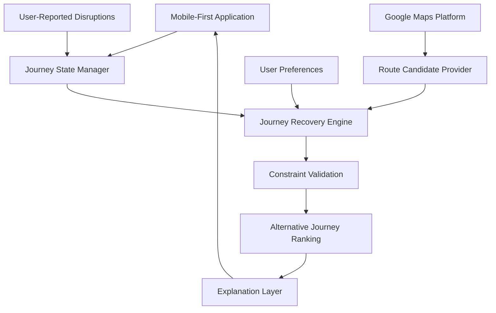

# 🟢 NAMMALINK

### One City. Every Connection.

**An Intelligent Journey Recovery Platform for Bengaluru**

*Because a missed connection shouldn't mean a lost journey.*

**Alliance One 2026 | SHASTRA | CodeSangram 3.0**

Official Problem Statement: `CS/26-002`

---

## 🌆 The Problem

Bengaluru's public transport connects millions of journeys, but moving between buses, metro services and walking segments can be challenging.

A delayed bus can cause a missed metro connection.

A missed connection can disrupt an entire journey.

Traditional route planning focuses on finding a route. **NammaLink explores what happens when that route no longer works.**

## 💡 Our Vision

NammaLink is a proposed mobile-first journey recovery platform that helps commuters adapt when public transport plans are disrupted.

Our goal is to turn fragmented transport choices into a more connected, accessible commuting experience.

> **We don't just want to plan journeys. We want to help people finish them.**

## ✨ Planned Capabilities

| Capability | Purpose |
|---|---|
| 🗺️ Connected Journey Planning | Explore supported multimodal routes |
| 🔄 Journey Recovery Engine | Find alternatives when a connection is disrupted |
| 🚏 Transfer Assistance | Understand walking time and transfer requirements |
| 🎯 Personal Travel Preferences | Consider affordability, walking constraints and accessibility |
| 📍 Interactive Map | Visualize journey segments and alternatives |
| 🌐 Localized Experience | Support English and Kannada |
| 🧩 Explainable Decisions | Show why a recovery option was recommended |

*These features are proposed, not yet implemented.*

## 🧠 Core Innovation Under Exploration

### Journey Recovery Engine

Rather than treating each route search as an isolated request, the proposed engine maintains a structured representation of a journey.

When an interruption occurs:

1. Identify the affected journey segment.
2. Preserve completed journey segments.
3. Identify remaining destinations and transfer constraints.
4. Generate feasible alternative routes.
5. Compare time, cost, walking requirements and reliability considerations.
6. Explain the available recovery choices.

The design will be evaluated against existing navigation solutions to establish its actual differentiation.

## 🏗️ Proposed Architecture

## 🛠️ Proposed Technology Stack

| Layer | Technology |
|---|---|
| Frontend | Next.js, React, TypeScript |
| UI | Tailwind CSS |
| Maps & Routing | Google Maps Platform, subject to API availability |
| Backend | Node.js / Next.js API routes |
| Database | PostgreSQL / Supabase |
| Decision Engine | Graph algorithms and constraint-based optimization |
| AI | Selective reasoning components where justified |
| Deployment | Vercel |

The stack may change after technical feasibility testing.

## 🎯 Our MVP Goal

Demonstrate a complete journey recovery workflow:

**Plan → Disruption → Recalculate → Compare → Continue**

The first prototype will focus on a small set of supported Bengaluru travel scenarios rather than claiming citywide real-time coverage.

## 📊 Planned Validation

- Recovery correctness across selected journey scenarios
- Route feasibility under transfer constraints
- End-to-end response time
- Successful completion of user workflows
- Accessibility and usability testing

## 🌍 Social Impact

**SDG 11:** Sustainable Cities and Communities

The project aims to make public transport easier to navigate, particularly for commuters managing complex transfers.

## 🗓️ Development Status

- [x] Initial problem statement reviewed
- [x] Preliminary product concept
- [ ] Competitor and novelty validation
- [ ] Architecture approval
- [ ] UI/UX prototype
- [ ] Working application
- [ ] Integration testing
- [ ] Live deployment
- [ ] Final demonstration

---

### Built for Bengaluru. Designed for Better Journeys.

**NammaLink | CodeSangram 3.0 | 2026**

*Concept under development.*

