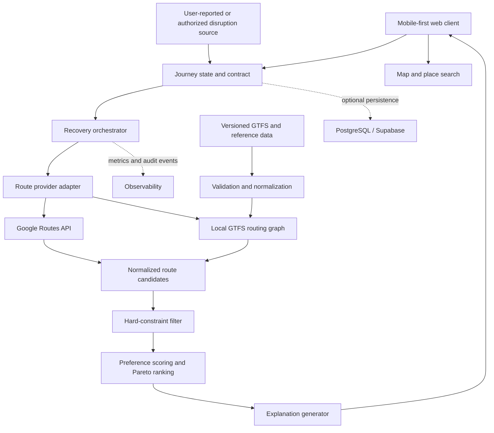

<div align="center">

# NammaLink

### Constraint-aware journey recovery for Bengaluru public transport

[](#project-status)
[](#hackathon)
[](#hackathon)

**Plan a journey. Preserve its requirements. Recover when it breaks.**

</div>

> [!IMPORTANT]
> NammaLink is in the **planning and technical-validation stage**. This repository does not yet contain a runnable application. Product capabilities, architecture, integrations, and setup steps labelled **Planned** are proposals, not implemented features.

## Contents

- [Overview](#overview)
- [Problem and motivation](#problem-and-motivation)
- [Project status](#project-status)
- [Journey Contract and Recovery Engine](#journey-contract-and-recovery-engine)
- [Features](#features)
- [Example recovery](#example-recovery)
- [Architecture](#architecture)
- [Technology plan](#technology-plan)
- [Dataset audit](#dataset-audit)
- [GTFS processing](#gtfs-processing)
- [API integration plan](#api-integration-plan)
- [Routing and recovery algorithms](#routing-and-recovery-algorithms)
- [Local setup](#local-setup)
- [Testing and success metrics](#testing-and-success-metrics)
- [Reliability, privacy, and security](#reliability-privacy-and-security)
- [Accessibility and social impact](#accessibility-and-social-impact)
- [Roadmap](#roadmap)
- [Contributing and licence](#contributing-and-licence)

## Overview

NammaLink is a proposed mobile-first urban-mobility platform for Bengaluru. Its focus is not merely finding a route. It is preserving a commuter's essential requirements when a planned journey is disrupted.

A user may need to arrive before a deadline, stay within a fare budget, avoid long walks, limit transfers, or require step-free access. NammaLink's proposed **Journey Contract and Recovery Engine** represents these requirements explicitly, evaluates replacement journeys, and explains the trade-offs. If no alternative satisfies every mandatory requirement, the product should say so clearly instead of presenting an infeasible route as a solution.

The first credible version will use selected Bengaluru scenarios and static data. It will not claim citywide live operations, guaranteed accessibility, or authoritative disruption detection without verified sources.

## Problem and motivation

Bengaluru journeys often combine BMTC buses, Namma Metro, suburban or mainline rail, and walking transfers. A delay in one leg can invalidate later connections. Conventional route search can return a new route, but it does not necessarily preserve the conditions that made the original journey acceptable.

NammaLink explores three related problems:

1. **Continuity:** preserve completed legs and recover only the unfinished journey.
2. **Feasibility:** enforce non-negotiable limits such as arrival time, cost, walking, transfers, and accessibility.
3. **Explainability:** show why an alternative was accepted, rejected, or ranked below another option.

This is the proposed differentiation. It still requires prototype testing and comparison against existing journey planners.

## Project status

Repository and workspace audit performed on **29 October 2026** against Git commit `6e6042a` on `main`.

| Evidence level | Finding |
| --- | --- |
| **Verified in repository** | Documentation plus a blank environment template and secret-protection rules exist: `README.md`, `.env.example`, and `.gitignore`. |
| **Verified in repository** | No application source, `package.json`, lockfile, tests, CI workflow, deployment configuration, database schema, or API integration exists. |
| **Verified in local data** | BMTC and BMRCL static GTFS tables, three BMRCL ridership workbooks, two KML maps, a Majestic platform CSV, and an older BMTC CSV bundle were inspected outside the Git repository. |
| **Verified from external documentation** | Google Routes API supports transit requests in general, with important restrictions documented below. The official documentation does not certify the exact quality or completeness of Bengaluru results. |
| **Planned** | Next.js application, Journey Contract model, recovery engine, Google Maps Platform integration, persistence, testing, and deployment. |
| **Needs validation** | Bengaluru route coverage from Routes API using a billing-enabled, restricted test key; BMTC/BMRCL real-time data access; accessibility completeness; dataset refresh process; and benchmark targets. |

### Implemented today

- Project concept and scope documentation.
- Local dataset collection and the audit recorded in this README.

### Not implemented today

- User interface or map.
- Route search, GTFS ingestion, graph construction, or recovery logic.
- Disruption ingestion or real-time vehicle data.
- Authentication, database, analytics, localization, testing, deployment, or monitoring.

## Journey Contract and Recovery Engine

A **Journey Contract** is a structured set of constraints and preferences attached to a journey.

| Type | Examples | Evaluation rule |
| --- | --- | --- |
| Hard constraint | Arrive by 09:15; fare at most ₹80; walk at most 800 m; at most two transfers; step-free path required | Reject any candidate that violates the constraint. |
| Soft preference | Fewer transfers; shorter travel time; lower cost; less walking; preferred modes | Rank feasible candidates and disclose trade-offs. |
| Context | Current position, completed legs, current time, destination, known disruption | Recompute only the remaining journey from the current state. |

The proposed recovery sequence is:

1. Capture the original route and Journey Contract.
2. Update journey state as legs are completed.
3. Receive a disruption signal or a user request to recover.
4. Freeze completed legs and determine the recovery origin and earliest departure time.
5. Retrieve alternative routes from approved providers and/or the local transit graph.
6. Normalize candidates into a provider-independent model.
7. Reject candidates that violate hard constraints.
8. Rank feasible candidates by soft preferences and Pareto dominance.
9. Explain the recommendation and its differences from the original journey.
10. If the feasible set is empty, report the violated constraints and offer explicit relaxation choices.

## Features

| Capability | Status | Notes |
| --- | --- | --- |
| Project concept and technical scope | **Verified** | Present in repository documentation. |
| Local static-data audit | **Verified** | Findings are documented below; raw data is not committed. |
| Mobile-first journey planning | **Planned** | Requires frontend and routing integration. |
| Journey Contract creation | **Planned** | Hard constraints must remain distinct from preferences. |
| Disruption-triggered recovery | **Planned** | Initial demo should use controlled or user-reported disruptions. |
| Explainable alternative comparison | **Planned** | Must show time, fare, walking, transfers, and violated constraints. |
| English and Kannada experience | **Planned** | Translation workflow and language review are not yet defined. |
| Accessibility-aware routing | **Planned / needs data** | Must not infer accessibility where source data is absent. |
| Live BMTC/BMRCL status | **Unavailable / unverified** | No authorized GTFS-Realtime or operator disruption feed was found in the repository or local data. |
| Occupancy prediction | **Out of MVP scope** | No suitable live or labelled occupancy source was verified. |

## Example recovery

**Original plan:** a commuter takes a BMTC bus to a metro interchange and expects to reach work by 09:15.

**Contract:** arrive by 09:15, spend no more than ₹80, walk no more than 800 m, make no more than two transfers, and prefer fewer transfers over a small time saving.

**Disruption:** the commuter reports that the bus is delayed and the planned metro connection is no longer reachable.

The engine preserves the completed travel and evaluates remaining-journey candidates:

| Candidate | Arrival | Fare | Walk | Transfers | Result |
| --- | ---: | ---: | ---: | ---: | --- |
| A | 09:12 | ₹74 | 650 m | 2 | Feasible; recommended. |
| B | 09:08 | ₹92 | 400 m | 2 | Rejected: exceeds budget. |
| C | 09:18 | ₹58 | 300 m | 1 | Rejected: misses deadline. |

The values above are a **design example**, not a benchmark or live API result. A production explanation would also cite the data timestamp and provider.

## Architecture



### Component responsibilities

| Component | Planned responsibility |
| --- | --- |
| Web client | Contract input, journey progress, disruption report, alternatives, map, and accessible UI. |
| Journey state | Original plan, completed legs, remaining destination, current location/time, and contract version. |
| Provider adapter | Keep Google and local-GTFS responses behind one normalized candidate interface. |
| GTFS pipeline | Download, checksum, validate, normalize, version, and build timetable/transfer indexes. |
| Recovery orchestrator | Re-query from the current state and request enough route diversity for evaluation. |
| Contract evaluator | Enforce mandatory limits without converting missing data into a false pass. |
| Ranker | Compare feasible routes using declared preferences, not hidden weights. |
| Explanation layer | Produce evidence-based reasons and constraint violations from deterministic calculations. |
| Persistence | Optional storage for saved contracts and journey state; avoid retaining precise location longer than needed. |

## Technology plan

No technology in this table is implemented in the repository yet.

| Layer | Planned choice | Reason |
| --- | --- | --- |
| Frontend | Next.js, React, TypeScript | Mobile-first UI, typed domain model, server endpoints, and straightforward Vercel deployment. |
| Styling | Tailwind CSS | Rapid, consistent prototyping with explicit accessibility review. |
| Map | Google Maps JavaScript API | Interactive base map, markers, and route polylines. |
| Route candidates | Google Routes API plus a local GTFS router | Google supplies broad journey candidates; local GTFS enables transparent validation and controlled experiments. |
| Place search | Places API (New) | Autocomplete and place identifiers for origins and destinations. |
| Data processing | TypeScript or a separate Python ingestion job | Select after benchmarking GTFS validation and graph-build requirements. |
| Persistence | PostgreSQL via Supabase, only if justified | Useful for accounts, saved contracts, feedback, and audit events; unnecessary for the first stateless demo. |
| Hosting | Vercel | Suitable for the planned Next.js prototype; background data jobs may require a separate scheduled worker. |

Machine learning is **not required for the MVP**. Constraint evaluation, timetable routing, and explanations should be deterministic. A later reliability model would be justified only after acquiring timestamped, lawful, representative delay data and defining an evaluation baseline.

## Dataset audit

The inspected datasets are local workspace files and are **not tracked by this Git repository**. Paths below are shown relative to the repository root. Do not commit them automatically.

### Inventory

| Local path | Format and inspected size | Coverage and records | Provenance / status | Intended use and limitations |
| --- | --- | --- | --- | --- |
| `../bmtc/` | 12 GTFS text files; 204,344,405 bytes (about 194.9 MiB) | 4,434 routes; 9,960 stops; 57,836 trips; 1,540,686 stop times; 2,492,304 shape points; feed version `20260907`, valid `2026-09-07` to `2027-09-07` | [Vonter/bmtc-gtfs](https://github.com/Vonter/bmtc-gtfs), an **unofficial/community-produced** feed derived from the official Namma BMTC app; ODbL 1.0 with underlying BMTC rights noted | Development and network analysis. The publisher warns that app timetables/stop times can be inaccurate and that routes without functional live tracking may be absent. No GTFS-Realtime files were found. |
| `../bmrcl/` | 22 GTFS text files; 7,540,025 bytes (about 7.2 MiB) | 3 metro routes; 488 stop/platform/entrance records; 3,279 trips; 88,906 stop times; 4,541 shape points; feed version `20260817`, valid `2026-08-17` to `2027-08-17` | [Vonter/bmrcl-gtfs](https://github.com/Vonter/bmrcl-gtfs), an **unofficial/community-produced** feed derived from BMRCL timetable images and OpenStreetMap; ODbL 1.0 | Development and metro-routing experiments. Intermediate station times are modelled from spacing, dwell time, and speed; short-loop service may be incomplete. Not suitable as an authoritative minute-level live source. |
| `../hourly sept 2025.xlsx` | XLSX; 714,604 bytes | Two sheets: 2,490 entry rows and 2,490 exit rows; 83 stations for every date from 1–30 September 2025; 24 hourly fields plus totals; no blank cells or total mismatches observed | BMRCL data obtained through RTI; matches the structure documented by [Vonter/bmrcl-ridership-hourly](https://github.com/Vonter/bmrcl-ridership-hourly) and [OpenCity](https://data.opencity.in/dataset/bmrcl-station-wise-ridership-data); community republication under ODbL 1.0 notes underlying BMRCL rights | Demand analysis, test-scenario selection, and validation. Historical aggregate counts, not routing, delay, capacity, or live occupancy data. |
| `../Station-wise Hourly Data - August 2025.xlsx` | XLSX; 244,975 bytes | 1,355 station-day rows, 83 unique stations, 1–18 August 2025, 24 hourly fields plus total; daily station coverage varies from 68 to 83; no blank cells or total mismatches observed | BMRCL RTI data; listed by [OpenCity](https://data.opencity.in/dataset/bmrcl-station-wise-ridership-data) | Historical entry-demand validation. The shorter period and changing station coverage must be handled explicitly. |
| `../Station-wise Hourly Data - August 20250.xlsx` | XLSX; 12,595,712 bytes | 27,516 rows; 83 station-code columns; 374 date-hour groups across 1–18 August 2025; 1,305 rows have a blank `STATION` field and appear to be aggregate/control rows | BMRCL RTI station-pair workbook; aligns with the station-pair dataset described by [Vonter](https://github.com/Vonter/bmrcl-ridership-hourly/blob/main/DATA.md) | Origin-destination demand research. Requires a station-code dictionary and explicit parsing of aggregate rows before use. Not a route schedule. |
| `../BMTC Majestic Bus Stand Platform Routes.csv` | CSV; 39,242 bytes; 427 rows | Platform, route, origin, destination, and via fields; no blank fields observed | [OpenCity resource](https://data.opencity.in/dataset/bengaluru-public-transport-infrastructure/resource/5a36e686-03c3-415c-b790-5c96af5ff9b6), attributed to BMTC; **no licence provided** on the resource | Majestic transfer guidance and demo validation only. Currency and update process are not established; do not redistribute without permission review. |
| `../BMTC Majestic Bus Stand Platform Map.kml` | KML; 137,796 bytes; 57 line-string placemarks | Platform geometry, with names such as Platform 1–4 | [OpenCity collection](https://data.opencity.in/dataset/bengaluru-public-transport-infrastructure); **no licence provided** | Visual transfer context. Not a pedestrian network and not proof of accessibility. |
| `../Metro and Railways Lines Map of Bengaluru.kml` | KML; 419,352 bytes; 597 line-string placemarks | Metro and railway line geometry in and around Bengaluru | [OpenCity resource](https://data.opencity.in/dataset/bengaluru-railway-and-metro-lines-map/resource/35d62279-3a44-4876-a6d6-a3fc1bb705a1); credit Nishanth C; CC Attribution | Background visualization and cross-checking, not a timetable or routing source. |
| `../BMTC Route with coordinates.zip` and extracted `../BMTC Route with coordinates/` | ZIP, 352,803 bytes; five extracted CSVs totalling about 1.9 MB | `routes.csv` 4,271 rows; `routes_with_coordinates.csv` 4,271 rows; `stop_times.csv` 15,017; `stops.csv` 4,433; `trips.csv` 15,170 | Embedded files contain no source, licence, feed-info, or attribution metadata; provenance is **unverified** | Legacy comparison only. Only 119 of 4,271 route rows have coordinates, `trips.csv` has no shape IDs, and required GTFS companion files are absent. Unsuitable for production routing. |

### GTFS file manifest

| GTFS table | BMTC | BMRCL | Role |
| --- | ---: | ---: | --- |
| `agency.txt` | 1 row | 1 row | Operator metadata. |
| `stops.txt` | 9,960 rows | 488 rows | Stops, stations, platforms, and entrances as represented by each feed. |
| `routes.txt` | 4,434 rows | 3 rows | BMTC bus routes and BMRCL metro lines. |
| `trips.txt` | 57,836 rows | 3,279 rows | Scheduled trips. |
| `stop_times.txt` | 1,540,686 rows | 88,906 rows | Ordered arrivals and departures. |
| `calendar.txt` | 1 row | 4 rows | Base service calendars. |
| `calendar_dates.txt` | **Not Found** | 64 rows | Service exceptions. Absence in BMTC means no explicit exceptions are available. |
| `shapes.txt` | 2,492,304 rows | 4,541 rows | Route geometry. |
| `transfers.txt` | **Not Found** | 16 rows | Explicit transfers and minimum transfer time. |
| `fare_attributes.txt` | 110 rows | 9 rows | Legacy GTFS fare products. |
| `fare_rules.txt` | 170,161 rows | 6,806 rows | Legacy fare applicability. |
| `feed_info.txt` | 1 row | 1 row | Feed publisher, version, and validity. |
| `pathways.txt` | **Not Found** | 486 rows | Station-internal paths. |
| Fares v2 tables | **Not Found** | `fare_media.txt` 4, `fare_products.txt` 39, `fare_leg_rules.txt` 40,836, `timeframes.txt` 12 | More detailed fare representation. |

The inspected core references are internally consistent: all trip-to-route, trip-to-shape, stop-time-to-trip, and stop-time-to-stop references resolved, and no duplicate `(trip_id, stop_sequence)` pairs were found. This does **not** establish real-world accuracy.

### Important data-quality findings

- BMTC `stops.txt` and `shapes.txt` extend from roughly 12.03°N to 17.77°N and 75.12°E to 78.39°E. That is far beyond Bengaluru and requires outlier investigation before spatial indexing or map fitting.
- The BMTC source explicitly warns of inaccurate timetables and incomplete coverage tied to functional live tracking in the source app.
- BMRCL intermediate times are estimates and may differ from operations by a few minutes. Short-loop services may be incomplete.
- Neither local GTFS feed contains verified GTFS-Realtime trip updates, service alerts, or vehicle positions.
- No inspected file establishes live breakdowns, occupancy, lift outages, or authoritative accessibility status.
- The ridership workbooks describe historical passenger counts. They must not be presented as current crowding predictions.

### Repository hygiene

Raw datasets should remain outside Git until redistribution rights and size limits are reviewed. Prefer a versioned manifest containing source URL, retrieval time, upstream version, checksum, licence, and expected tables. Add generated data and secrets to `.gitignore` when the application is scaffolded, for example:

```gitignore
.env*
!.env.example
data/raw/
data/processed/
*.gtfs.zip
```

## GTFS processing

The planned ingestion pipeline is reproducible and fail-closed:


Minimum validation includes required files and columns, unique primary keys, foreign-key resolution, ordered stop sequences, monotonic times, coordinate bounds, service-date coverage, fare currency, transfer consistency, duplicate detection, and a recorded upstream licence. Failed validation must keep the previous known-good snapshot active.

## API integration plan

Every API below is **planned**; none is called by the current repository.

| Priority | Service | Proposed use | Interface and authentication | Key limitations |
| --- | --- | --- | --- | --- |
| P0 | [Google Maps Routes API](https://developers.google.com/maps/documentation/routes) | Retrieve transit alternatives and leg details from the current recovery point | Server-side `POST https://routes.googleapis.com/directions/v2:computeRoutes`; API key or supported OAuth; field mask required | Transit has no intermediate waypoints, avoid-feature controls, or traffic settings. Preferences are limited to fewer transfers or less walking. Returned alternatives remain subject to provider coverage. |
| P0 | [Maps JavaScript API](https://developers.google.com/maps/documentation/javascript/overview) | Base map, markers, route polylines, transfer context | Browser SDK via `google.maps.importLibrary()`; API key restricted to approved HTTPS referrers and the Maps JavaScript API | A browser key is visible by design and must be restricted. Google attribution and display rules apply. |
| P0 | [Places API (New)](https://developers.google.com/maps/documentation/places/web-service/overview) | Origin/destination autocomplete and canonical place IDs | Autocomplete (New), Place Details (New), optionally Text Search (New); API key or supported OAuth; use session tokens and field masks | Billing depends on requested fields/SKU. Places content generally cannot be prefetched, cached, or stored except where policy allows; place IDs are the principal storage exception. |
| P1 | [Geocoding API](https://developers.google.com/maps/documentation/geocoding/overview) | Fallback conversion between addresses and coordinates when Places/route inputs are insufficient | Server-side geocoding endpoint with a restricted API key | Likely redundant for the MVP because Routes accepts coordinates/place IDs and Places handles search. Caching restrictions apply; place IDs can be stored indefinitely. |
| P2 | [OpenStreetMap Overpass API](https://wiki.openstreetmap.org/wiki/Overpass_API) | Development-time queries for stops, entrances, lifts, and pedestrian context not supplied by GTFS | Overpass QL via an `/api/interpreter` endpoint; public instances usually have no application key | Public instances are shared, rate-limited, and intended for modest use. Data may be incomplete or stale. Cache derived extracts, attribute OpenStreetMap, follow ODbL, and use regional extracts or a dedicated service for production. |

### Routes API transit finding

The official Routes API documentation confirms `travelMode: "TRANSIT"`, transit steps, stop and line details, optional fares, departure/arrival time, mode preferences, fewer-transfer/less-walking preferences, and alternative routes. It also states:

- Transit requests cannot include intermediate waypoints.
- Arrival or departure times are limited to seven days in the past through 100 days in the future.
- Up to three additional routes may be returned when available.
- A preferred transit mode is not a hard restriction; results may use another mode.
- Fare is returned only when Google can determine it for every transit step.

This is technically useful for NammaLink, but it does not prove that every required BMTC or BMRCL journey in Bengaluru is present or accurate. Before committing to the provider, run a dated coverage test with representative bus-only, metro-only, and mixed journeys and compare returned stops, trip times, fares, walking, and transfers against the inspected GTFS and field observations.

Google Maps Platform was not verified as a source for live BMTC breakdown notifications, occupancy, lift status, or complete vehicle positions. NammaLink must not claim those capabilities without an authorized data agreement and tested feed.

### Cloud, billing, and security requirements

1. Create separate development and production Google Cloud projects with billing enabled.
2. Enable only Routes API, Maps JavaScript API, and Places API (New) initially.
3. Use separate browser and server credentials. Restrict the browser key by HTTPS referrer and API; keep the server credential secret and restrict it by API plus IP where the hosting model permits.
4. Route web-service calls through trusted server endpoints. Do not accept an arbitrary upstream URL or arbitrary Google request body from clients.
5. Request only necessary response fields. Field masks affect latency and Places billing.
6. Configure quota caps, budget alerts, monitoring, and abuse detection before a public demo.
7. Review the current [Google Maps Platform pricing list](https://developers.google.com/maps/billing-and-pricing/pricing), [security guidance](https://developers.google.com/maps/api-security-best-practices), and product policies before release.
8. Do not mix Google content into a non-Google map or persist/reconstruct provider content unless the applicable terms expressly allow it.

## Routing and recovery algorithms

### Candidate generation

- Use Routes API `computeRoutes` for provider-backed journey candidates.
- Build a local time-dependent transit graph from GTFS for controlled scenarios and coverage checks.
- Use RAPTOR or McRAPTOR for timetable-based multi-criteria public-transport search.
- Use Dijkstra or A* for pedestrian/transfer subgraphs where edge costs are non-negative and the data supports them.
- Use bounded k-shortest-path or Pareto search to increase route diversity without enumerating the full graph.

### Constraint evaluation

For each normalized candidate:

1. Compute arrival time, known fare, walking distance, transfer count, and accessibility evidence.
2. Mark missing mandatory evidence as **unknown**, not automatically feasible.
3. Apply all hard predicates. A candidate is feasible only if every mandatory predicate passes.
4. Calculate a transparent preference score for feasible routes, or retain the Pareto frontier when no single weighting is appropriate.
5. Use deterministic reason codes to generate explanations such as `BUDGET_EXCEEDED`, `DEADLINE_MISSED`, or `ACCESSIBILITY_UNKNOWN`.

The engine should never use a language model to decide whether a hard constraint passed. Natural-language generation may format an already computed explanation, but the facts and reason codes must come from deterministic logic.

## Local setup

### Current repository

There is no application to install yet.

```bash
git clone https://github.com/DSGAMING98/NammaLink.git
cd NammaLink
```

At the audited commit, this opens the documentation only. `npm install` and `npm run dev` will not work because `package.json` does not exist.

### Planned setup after the application scaffold lands

The following is a target workflow, not a currently executable one:

```bash
npm install
cp .env.example .env.local
npm run dev
```

Copy the committed blank template to `.env.local`, then fill only the services you enable. The local file is ignored by Git.

```dotenv
# Browser key: visible to clients; restrict to allowed HTTPS referrers and Maps JavaScript API.
NEXT_PUBLIC_GOOGLE_MAPS_API_KEY=replace_with_restricted_browser_key
NEXT_PUBLIC_GOOGLE_MAPS_MAP_ID=replace_with_map_id

# Server-only keys: never prefix with NEXT_PUBLIC_.
GOOGLE_ROUTES_API_KEY=replace_with_restricted_routes_key
GOOGLE_PLACES_API_KEY=replace_with_restricted_places_key
GOOGLE_GEOCODING_API_KEY=replace_with_restricted_geocoding_key

# Public Overpass instances normally use a URL, not an API key.
OVERPASS_API_URL=https://overpass-api.de/api/interpreter

# Add only if Supabase is adopted.
NEXT_PUBLIC_SUPABASE_URL=replace_with_project_url
NEXT_PUBLIC_SUPABASE_ANON_KEY=replace_with_anon_key
SUPABASE_SERVICE_ROLE_KEY=replace_with_server_only_service_role_key
```

`.env.example` contains blank, safe-to-share slots. Put real values only in `.env.local`. Actual `.env` files and credentials must never be committed.

## Directory structure

### Verified current structure

```text
NammaLink/
├── .env.example              # Blank, safe-to-share variable template
├── .gitignore                # Excludes local secrets and generated data
└── README.md
```

### Planned structure

```text
NammaLink/
├── app/                       # Next.js routes and mobile-first screens
├── components/                # UI and accessible map controls
├── lib/
│   ├── contracts/             # Journey Contract schema and validation
│   ├── providers/             # Google and local routing adapters
│   ├── recovery/              # Candidate filtering, ranking, explanations
│   └── gtfs/                  # Ingestion and normalized transit model
├── data/
│   └── manifest.example.json  # Sources and checksums, not raw datasets
├── scripts/                   # Reproducible validation/import commands
├── tests/                     # Unit, integration, scenario, and accessibility tests
├── .env.example
├── .gitignore
├── package.json
└── README.md
```

This target tree should be updated to match the code after scaffolding; it is not evidence of current files.

## Testing and success metrics

### Test strategy

| Layer | Planned checks |
| --- | --- |
| Data contract | Schema, unique IDs, foreign keys, service dates, monotonic times, coordinate bounds, licences, and checksums. |
| Unit | Hard constraints, unknown evidence, fare aggregation, transfer counting, tie-breaking, and reason codes. |
| Property-based | A route that violates a hard limit is never marked feasible; relaxing a limit cannot invalidate a previously feasible route for that limit alone. |
| Provider contract | Recorded, redacted fixtures for field masks, transit details, absent fares, zero results, and quota errors. |
| Scenario | Bus-only, metro-only, bus–metro, missed connection, no feasible route, and accessibility-unknown cases. |
| UI/accessibility | Keyboard navigation, screen-reader labels, focus order, contrast, reduced motion, Kannada layout, and non-map alternatives. |
| Field validation | Compare selected predictions with observed Bengaluru journeys and document timestamp, provider, and deviation. |

### Proposed metrics

Targets will be set only after a baseline prototype. The project should measure:

- **Constraint safety:** percentage of recommended routes that satisfy all hard constraints.
- **Recovery coverage:** percentage of test disruptions with at least one correctly identified feasible alternative.
- **False-feasible rate:** routes recommended despite a violated or unknown mandatory requirement; target should be zero for deterministic tests.
- **Explanation fidelity:** percentage of explanations that exactly match computed reason codes and deltas.
- **Latency:** median and 95th-percentile recovery time, separated into provider, evaluation, and rendering time.
- **Data freshness:** age and validation status of every active feed.
- **Accessibility task completion:** success rate for contract creation, recovery comparison, and route selection.

No performance result is claimed today.

## Reliability, privacy, and security

### Data reliability

- Show provider, feed version, and retrieval time beside route evidence.
- Treat scheduled time as an estimate, not a live guarantee.
- Distinguish `false`, `true`, and `unknown` for accessibility and fare evidence.
- Keep controlled demo disruptions separate from real operator alerts.
- Provide a safe fallback when the route provider is unavailable or returns no candidates.
- Never infer an operator disruption from historical ridership alone.

### Privacy

- Minimize collection of precise location and journey history.
- Process an active journey in memory where practical; persist only with clear user value and consent.
- Define retention and deletion before enabling accounts or analytics.
- Avoid placing precise origin/destination data in logs, URLs, analytics events, or error reports.
- If Supabase is adopted, enable row-level security and test every policy.

### Security

- Keep server keys and service-role credentials outside the client bundle.
- Restrict every Google key by application and API; use separate keys for browser and server traffic.
- Validate and rate-limit public endpoints, apply request timeouts, and cap candidate fan-out.
- Redact provider payloads before storing test fixtures or logs.
- Add dependency, secret, and licence scanning when code is introduced.

## Dataset licences and acknowledgements

- The inspected [Vonter BMTC GTFS](https://github.com/Vonter/bmtc-gtfs), [Vonter BMRCL GTFS](https://github.com/Vonter/bmrcl-gtfs), and [Vonter BMRCL ridership dataset](https://github.com/Vonter/bmrcl-ridership-hourly) are published under ODbL 1.0; their repositories note that some individual contents remain under operator copyright. Attribution and share-alike obligations must be reviewed before redistribution or publication of an adapted database.
- OpenStreetMap-derived content requires OpenStreetMap attribution and ODbL compliance.
- The OpenCity railway/metro KML is listed under Creative Commons Attribution with credit to Nishanth C.
- The OpenCity Majestic platform CSV and KML list no licence. Keep them out of redistribution until permission is clarified.
- The older BMTC coordinate bundle has unverified provenance and licence and should not be shipped.

Acknowledgements: Bengaluru Metropolitan Transport Corporation, Bangalore Metro Rail Corporation Limited, OpenStreetMap contributors, OpenCity, and the community dataset maintainers. Their mention does not imply endorsement of NammaLink.

## Accessibility and social impact

Accessibility is a routing requirement, not a decorative feature. The planned product should support large touch targets, keyboard and screen-reader use, readable contrast, text alternatives to maps, reduced motion, and clear language in English and Kannada. Route accessibility must remain **unknown** when lifts, pathways, kerbs, or vehicle boarding evidence is unavailable.

NammaLink aligns with **UN Sustainable Development Goal 11: Sustainable Cities and Communities**, particularly the goal of accessible and sustainable transport. The project can contribute by making multimodal public transport easier to continue during disruptions. The alignment is an objective, not a measured impact claim.

## Hackathon

| Field | Detail |
| --- | --- |
| Event | Alliance University CodeSangram 3.0 |
| Problem statement | `CS/26-002: Smart Public Transport Optimization` |
| Project | NammaLink |
| Stage | Planning and technical validation |
| Demonstration goal | A small, reproducible Bengaluru journey-recovery workflow with transparent constraints and evidence |

## Roadmap

1. **Freeze the evidence base:** create a source manifest, checksums, licence notes, and repeatable GTFS validation report.
2. **Run a Routes API spike:** test at least 20 representative Bengaluru journeys across BMTC, BMRCL, mixed modes, peak/off-peak periods, and known transfers.
3. **Define the domain model:** versioned Journey Contract, route candidate, leg, disruption, and reason-code schemas.
4. **Implement a deterministic evaluator:** hard filters, unknown-data handling, preference ranking, and explanation facts with unit tests.
5. **Build one end-to-end demo:** plan → simulated disruption → recover → compare → continue.
6. **Add local GTFS routing:** use a small validated snapshot to cross-check provider coverage and support reproducible scenarios.
7. **Test accessibility and Kannada UI:** include non-map workflows and manual review.
8. **Decide persistence only after need is proven:** add Supabase for saved contracts or feedback, not by default.
9. **Add CI, deployment, and observability:** only after the test suite and secret model exist.
10. **Seek authorized real-time sources:** do not reverse-engineer undocumented BMTC or BMRCL endpoints for production.

## Missing requirements

- Billing-enabled, restricted Google Maps Platform credentials for a coverage spike.
- Verified Bengaluru transit results from Routes API and a documented acceptance threshold.
- Authorized real-time disruption, trip-update, vehicle-position, occupancy, and lift-status sources.
- A licence decision for NammaLink's own source code.
- Team/contributor information, ownership of deployment accounts, and privacy/retention decisions.
- Provenance and licence for `BMTC Route with coordinates.zip`.
- Licence or permission clarification for the Majestic platform CSV/KML.
- A source manifest, automated GTFS validator output, and repeatable refresh process.
- Application code, tests, CI, and deployment configuration.

## Contributing and licence

The repository is not yet ready for general contributions because the codebase and contribution workflow do not exist. When implementation begins, add issue templates, code style, test requirements, a security-reporting path, and a contribution guide.

**No licence has been selected for NammaLink's repository content.** Until a `LICENSE` file is added, do not assume permission to copy, modify, or redistribute the project. Dataset licences are separate and do not determine the licence for NammaLink source code.

---

<div align="center">

**NammaLink — journey recovery that respects the journey contract**

Planning-stage project for CodeSangram 3.0

</div>
