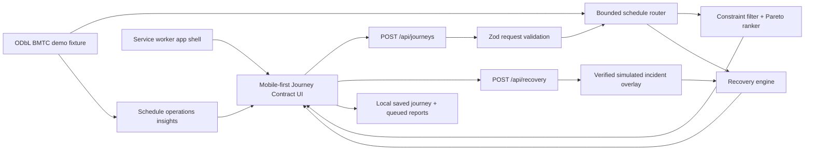

# NammaLink architecture

Last updated: 29 October 2026

## System boundary

NammaLink is currently a single Next.js application with a pure TypeScript transit domain. The runnable prototype is intentionally local-first: static schedule data is committed as a bounded licensed fixture, routing and recovery are deterministic, and no database or paid API is required for the core demonstration.

## Components

| Component | Responsibility | Evidence |
| --- | --- | --- |
| App Router UI | Journey Contract inputs, scheduled itinerary, recovery simulation, connection state, operator insight | `app/`, browser QA |
| Journey API | Validate coordinates, date, deadline, walking, transfers, and preference | `app/api/journeys/route.ts` |
| Transit domain | GTFS time parsing, calendars, nearby-stop distance, schedule enumeration, constraints, ranking | `lib/transit/` |
| Recovery domain | Evidence states, scoring, affected-leg detection, preserved-leg recovery | `lib/disruptions/` |
| Offline storage | Last itinerary and bounded, deduplicated report queue | `lib/offline/` |
| Schedule insights | Route trip counts, spans, headways, and shared stops | `lib/insights/` |
| Data build | Extract selected routes and their dependencies from local BMTC GTFS | `scripts/build-demo-network.mjs` |

## Request flow

1. The browser submits the fixed campus coordinates and the passenger's contract.
2. The API validates the payload and calls the pure router against the bounded fixture.
3. The router applies service calendars, access/egress walking, transfer feasibility, deadlines, and hard limits before ranking.
4. The browser displays only source-labelled scheduled results and saves the last response locally.
5. The recovery demonstration creates a clearly synthetic incident affecting the second trip, preserves the completed first leg, and replans from Banashankari.
6. When the original deadline is impossible, the response names the relaxed constraint and shows the next action.

## Security and privacy

- `.env.local` is ignored; server keys are not imported by client components.
- API input is schema-validated and numerically bounded.
- Security headers disable framing, MIME sniffing, and permissive referrer leakage.
- The service worker excludes API responses from its cache.
- Saved journeys and report drafts remain on the current device. The UI states that drafts are not uploaded.
- No continuous location, account, email, SMS, or push permission is required.
- Supabase credentials exist locally but no schema or authorization policy has been verified, so authentication is not enabled.

## Scale path

The bounded enumerator is a correctness-oriented prototype. City-scale routing should materialize date-specific services and use CSA or RAPTOR with a spatial index, explicit station transfers, pedestrian-network routing, request budgets, and benchmarked latency. BMRCL and any future KSRTC data must retain operator-specific identifiers and provenance.

## External integrations

Google keys are locally present, but minimal Places requests returned HTTP 403. Google maps/place/routing features are therefore blocked and not part of the working core. An authorized realtime feed, notification provider, and verified Supabase backend are also absent. The architecture keeps those optional so schedule planning continues without them.
