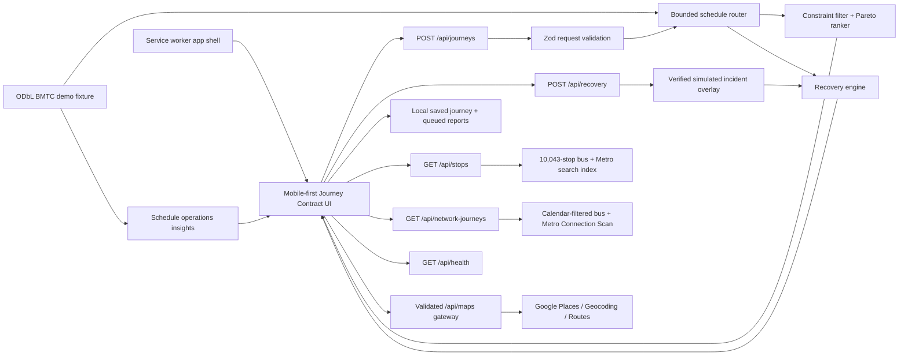

# NammaLink architecture

Last updated: 30 October 2026

## System boundary

NammaLink is a deployable Next.js service with a pure TypeScript transit domain and a native Android client. Static schedule routing remains deterministic and independent of paid APIs. Optional map functions cross a server-only Google gateway so provider keys are never compiled into Android or browser bundles.

## Components

| Component | Responsibility | Evidence |
| --- | --- | --- |
| App Router UI | Journey Contract inputs, scheduled itinerary, recovery simulation, connection state, operator insight | `app/`, browser QA |
| Journey API | Validate coordinates, date, deadline, walking, transfers, and preference | `app/api/journeys/route.ts` |
| Transit domain | GTFS time parsing, calendars, nearby-stop distance, schedule enumeration, constraints, ranking | `lib/transit/` |
| Recovery domain | Evidence states, scoring, affected-leg detection, preserved-leg recovery | `lib/disruptions/` |
| Offline storage | Last itinerary and bounded, deduplicated report queue | `lib/offline/` |
| Schedule insights | Route trip counts, spans, headways, and shared stops | `lib/insights/` |
| Data build | Extract selected routes and their dependencies from local BMTC GTFS | `scripts/build-demo-network.mjs` |
| Stop discovery | Normalized text search plus bounded great-circle nearby lookup across 9,960 BMTC stops and 83 BMRCL stations | `app/api/stops/`, `lib/transit/stop-search.ts`, `data/transit-stops.json` |
| Full-network routing | GTFS-calendar-filtered scan over 1,563,324 bus/Metro connections and 670 explicit transfer footpaths; optional current-location access reserves walking budget before the scan | `app/api/network-journeys/`, `lib/transit/connection-router.ts` |
| Native Android | Compose planner, on-demand platform location and nearby-stop selection, real-coordinate geographic fallback, offline demonstration, recovery, versioned full-itinerary local restoration, and full-feed operator evidence | `android/`, physical-device QA |
| Readiness and versioning | Secret-safe service, revision, dataset-validity, and capability contract | `app/api/health/` |
| Maps gateway | Bounded validation, Bengaluru bias, timeouts, per-client rate limiting, normalized errors, and server-only provider credentials | `app/api/maps/`, `lib/server/` |
| Deployment | Standalone Next.js output plus non-root multi-stage container and repeatable release checks | `Dockerfile`, `docs/DEPLOYMENT.md`, `.github/workflows/ci.yml` |

## Request flow

1. The browser submits the fixed campus coordinates and the passenger's contract.
2. The API validates the payload and calls the pure router against the bounded fixture.
3. The router applies service calendars, access/egress walking, transfer feasibility, deadlines, and hard limits before ranking.
4. The browser displays only source-labelled scheduled results and saves the last response locally.
5. The recovery demonstration creates a clearly synthetic incident affecting the second trip, preserves the completed first leg, and replans from Banashankari.
6. When the original deadline is impossible, the response names the relaxed constraint and shows the next action.

## Security and privacy

- `.env.local` is ignored; server keys are not imported by client components.
- API input is schema-validated and numerically bounded.
- Security headers disable framing, MIME sniffing, and permissive referrer leakage.
- Map requests receive opaque request IDs, bounded inputs, timeouts, stable error codes, and privacy-safe failure logs.
- A tracked-file secret hygiene gate runs locally and in CI.
- The service worker excludes API responses from its cache.
- Saved journeys and report drafts remain on the current device. The UI states that drafts are not uploaded.
- No continuous location, account, email, SMS, or push permission is required.
- Supabase credentials exist locally but no schema or authorization policy has been verified, so authentication is not enabled.

## Scale path

The bounded enumerator remains the deterministic multi-constraint reference engine. City-scale BMTC/BMRCL stop-to-stop routing uses a benchmarked CSA binary index with service calendars, station/platform normalization, and estimated bus–Metro transfer walks. Future KSRTC data must retain operator-specific identifiers and provenance.

## External integrations

Google Routes and Geocoding live authorization probes pass. Places Autocomplete currently returns HTTP 403 because the configured key rejects server requests without an HTTP referrer; the gateway is implemented but remains degraded until the key restriction is corrected. An authorized realtime feed, notification provider, and verified Supabase backend are also absent. The architecture keeps all of these optional so schedule planning continues without them.
